<a href="https://aranshayan.com">
  <picture>
    <source media="(prefers-color-scheme: dark)" srcset="assets/header-dark.svg">
    
  </picture>
</a>

  <a href="https://aranshayan.com"><b>Portfolio</b></a>
  &nbsp;·&nbsp;
  <a href="https://aranshayan.com/hire">For recruiters</a>
  &nbsp;·&nbsp;
  <a href="https://aranshayan.com/aran-shayan-resume.pdf">Résumé (PDF)</a>
  &nbsp;·&nbsp;
  <a href="https://www.linkedin.com/in/aran-shayan-7b0b1a194">LinkedIn</a>
  &nbsp;·&nbsp;
  <a href="mailto:hi@aranshayan.com">hi@aranshayan.com</a>

Six years in software: four leading the frontend of enterprise and banking platforms, two building backend services before that. I build fast, accessible, data heavy interfaces with React, Next.js and TypeScript, and I design the APIs and data models behind them when a product needs it.

## Highlights

- Led the frontend of an API integration platform for banks and telecom operators, including a no-code builder for connecting APIs.
- Designed an authorization control plane and the tenancy and organisation services behind an ERP, from data model to OpenAPI contract.
- Built liquidity supervision and settlement reporting interfaces that run in production at a national bank.
- Found a SQL injection risk in the platform's database nodes and specified the fix across six database engines.
- Created the shared design system and kept data heavy screens fast with virtualisation and careful state management.

## Live demos

My client work runs behind bank firewalls, so I rebuilt the hard parts in the open. Plain React and TypeScript, no component libraries.

  <a href="https://aranshayan.com/lab/grid"><picture><source media="(prefers-color-scheme: dark)" srcset="assets/lab-grid-dark.svg"></picture></a>
  <a href="https://aranshayan.com/lab/dashboard"><picture><source media="(prefers-color-scheme: dark)" srcset="assets/lab-monitor-dark.svg"></picture></a>
  <a href="https://aranshayan.com/lab/flow"><picture><source media="(prefers-color-scheme: dark)" srcset="assets/lab-flow-dark.svg"></picture></a>

## AI and models

  <a href="https://aranshayan.com/services/ai-agents"><picture><source media="(prefers-color-scheme: dark)" srcset="assets/ai-agent-dark.svg"></picture></a>
  <a href="https://aranshayan.com/work/cold-start-recommender"><picture><source media="(prefers-color-scheme: dark)" srcset="assets/ai-research-dark.svg"></picture></a>

- **Assistants on your data:** retrieval over documents, tickets or databases, with citations so people can check every answer.
- **Tool calling agents:** agents that call internal APIs to get work done, with clear limits and a confirmation step for risky actions.
- **Evaluations:** test sets and automated checks that measure quality before and after every prompt or model change.
- **Model choice:** whatever fits the task, cost and data rules. The system is built so the model can be swapped without a rewrite, and personal data is masked before it reaches a model.
- **Research:** a meta-learning recommender for new users, with MAML and a prototypical network on graph, geographic and social features. +21.7% NDCG@10 and +26.3% Recall@10 over a graph neural network baseline, and the prototypical network trains 3.5x faster than MAML at similar accuracy. [Case study](https://aranshayan.com/work/cold-start-recommender) · [Article](https://aranshayan.com/writing/meta-learning-cold-start) · [Code](https://github.com/aranshayan/cold-start-poi-recsys)

AI stack: AI SDK, TypeScript, Python, pgvector, LangGraph, PyTorch, graph neural networks.

## Case studies

- [API Platform](https://aranshayan.com/work/api-platform): enterprise API management for banks and telecom operators
- [Access Control](https://aranshayan.com/work/access-control): a control plane for fine-grained permissions
- [Branch Liquidity](https://aranshayan.com/work/branch-liquidity): cash supervision across a bank's branch network
- [Alita](https://aranshayan.com/work/alita): a local-first system manager for developers and their teams

## Writing

- [A million rows in the browser](https://aranshayan.com/writing/million-row-grid)
- [APIs a frontend can live with: designing the contract first](https://aranshayan.com/writing/contract-first-apis)
- [A design system for products people use all day](https://aranshayan.com/writing/design-system-for-enterprise)
- [Hide the button, enforce on the server](https://aranshayan.com/writing/authorization-multi-tenant)

## Stack

<picture>
  <source media="(prefers-color-scheme: dark)" srcset="assets/stack-dark.svg">
  
</picture>

Every day: TypeScript, React, Next.js, HTML and CSS, Tailwind CSS. Most weeks: state and data fetching, testing, accessibility (WCAG), Core Web Vitals, design systems. Also REST and OpenAPI, SpiceDB and Keycloak.
