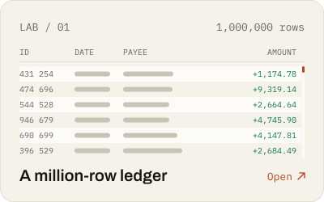

**Product engineer. I build data-heavy interfaces, the APIs behind them, and AI tools people can trust with real data.**

Six years in software: two building backend services, then banking and enterprise platforms since 2023, where a wrong number is worse than no number. That mix means I design a screen with the API, the database and the network in mind, and I bring the same habit to AI work: give the model only the access it needs, check its output with something that does not depend on trusting it, and measure quality before and after every change.

[Portfolio](https://aranshayan.com) · [Résumé (PDF)](https://aranshayan.com/aran-shayan-resume.pdf) · [LinkedIn](https://www.linkedin.com/in/aranshayan) · [X](https://x.com/aranshayan) · [hi@aranshayan.com](mailto:hi@aranshayan.com)

## Experience highlights

- Led the frontend of an API integration platform for banks and telecom operators, including a no-code builder for connecting APIs.
- Built liquidity supervision and settlement reporting interfaces that run in production at a national bank.
- Designed an authorization control plane and the tenancy services behind an ERP, from data model to OpenAPI contract.
- Found a SQL injection risk in the platform's database nodes and specified the fix across six database engines.
- Created the shared design system and kept data-heavy screens fast with virtualisation and careful state management.

## Selected work

**[statement-extract](https://github.com/aranshayan/statement-extract)**: Claude turns PDF bank statements into ledger-ready transactions, then plain arithmetic checks every balance to the cent before the data is trusted. Measured with an eval suite of 16 statement layouts from eight countries.

**[Tellerline](https://github.com/aranshayan/tellerline)**: accessible React components for banking and back-office apps, installed with the shadcn CLI. A money input that never rounds and keeps the caret in place, an audit timeline in the reader's time zone, and a maker-checker approval flow whose rules also run on the server. Tested with axe, and CI installs every component into a fresh Next.js app. [Docs and demos](https://tellerline-ui.vercel.app)

**[pg-guard-mcp](https://github.com/aranshayan/pg-guard-mcp)**: an MCP server that gives AI agents read-only, audited, PII-masked access to PostgreSQL. It assumes the agent will eventually be asked to do something it should not, and the database stays safe when it is.

**[cold-start-poi-recsys](https://github.com/aranshayan/cold-start-poi-recsys)**: MSc research on recommendations for new users, comparing prototypical networks and MAML on Foursquare check-ins. [Case study](https://aranshayan.com/work/cold-start-recommender) · [Article](https://aranshayan.com/writing/meta-learning-cold-start)

<a href="https://aranshayan.com/work/cold-start-recommender"><picture><source media="(prefers-color-scheme: dark)" srcset="assets/ai-research-dark.svg"></picture></a>

## Live demos

My client work runs behind bank firewalls, so I rebuilt the hard parts as demos you can open and try. Plain React and TypeScript, no component libraries.

  <a href="https://aranshayan.com/lab/grid"><picture><source media="(prefers-color-scheme: dark)" srcset="assets/lab-grid-dark.svg"></picture></a>
  <a href="https://aranshayan.com/lab/dashboard"><picture><source media="(prefers-color-scheme: dark)" srcset="assets/lab-monitor-dark.svg"></picture></a>
  <a href="https://aranshayan.com/lab/flow"><picture><source media="(prefers-color-scheme: dark)" srcset="assets/lab-flow-dark.svg"></picture></a>

## Tools for AI agents

- [mcp-web-reader](https://github.com/aranshayan/mcp-web-reader): web pages as clean Markdown, with SSRF protection and robots.txt support
- [mcp-docs-reader](https://github.com/aranshayan/mcp-docs-reader): PDF, Word, Excel and CSV as LLM-friendly text
- [mcp-git-insights](https://github.com/aranshayan/mcp-git-insights): read-only Git history and code archaeology
- [agent-skills](https://github.com/aranshayan/agent-skills): Agent Skills for SQL review, PR review, commits and research
- [page-to-markdown](https://github.com/aranshayan/page-to-markdown): a browser extension that copies a page or selection as Markdown

## Writing

- [A million rows in the browser](https://aranshayan.com/writing/million-row-grid)
- [APIs a frontend can live with: designing the contract first](https://aranshayan.com/writing/contract-first-apis)
- [Hide the button, enforce on the server](https://aranshayan.com/writing/authorization-multi-tenant)
- [A design system for products people use all day](https://aranshayan.com/writing/design-system-for-enterprise)
- [Meta-learning for cold-start recommendations](https://aranshayan.com/writing/meta-learning-cold-start)

## Stack

<picture>
  <source media="(prefers-color-scheme: dark)" srcset="assets/stack-dark.svg">
  
</picture>

Every day: TypeScript, React, Next.js, Tailwind CSS, Node.js. Often: PostgreSQL, REST and OpenAPI, testing, accessibility (WCAG), design systems. For AI work: Claude API, Model Context Protocol, Agent Skills, Python and PyTorch.

**Looking for** a frontend, full stack or applied AI role on product, data or platform teams. Remote.
